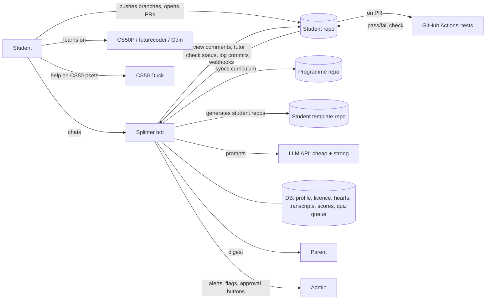

> **Edited for publication.** This is a copy of the original design document, edited for this public repo: names, family roles, the pilot student's age and gender, and infrastructure details were replaced with generic roles (*student*, *parent*, *admin/mentor*). Where this doc conflicts with the task brief or the ADRs in `docs/decisions/`, the ADRs win.

# Teen Coding Programme — Architecture with a Telegram Tutor

The reference tutor bot is called **Splinter** (a deployment may give it another name). Server setup and deployment are documented in the bot repo (`splinter-bot`); this doc covers the product and the programme.

*Roles used below:* **admin** = the programme owner / mentor who runs the bot and approves licence upgrades; **parent** = a parent or guardian who receives the weekly digest; **student** = the learner. "You" means the admin.

How the pieces fit together, one worked example module (variables, types and conditionals in Python), and what a week looks like from the student's side.

---

## 1. Who does what

| Piece | Role | Owned by |
|---|---|---|
| **External platforms** (CS50P, futurecoder, The Odin Project, later Hack Club) | Lessons, lectures, exercises and their auto-checkers. The "textbooks". | Third parties |
| **CS50 Duck** (cs50.ai) | The only AI help allowed *on CS50 problem sets* (CS50's rules) | Harvard CS50 |
| **Programme repo** | Curriculum as code: roadmap, modules, competencies, remix briefs, tests, rubrics, explain-back question banks, tutor prompts. The "syllabus". | You (admin) |
| **Student repo** | The student's work: notes, remix projects, PRs, log. Progress tracker and portfolio. The "gradebook". | Your GitHub org; the student has write access |
| **Student template repo** | GitHub template repository: the minimal skeleton each student repo is generated from | You |
| **GitHub Actions** | Runs the tests on each PR. The automatic judge of "does it work". | Workflow from the template |
| **Splinter (Telegram bot)** | The tutor: hints, concept explanations, PR reviews, explain-back checks, quizzes, nudges, parent digest. Enforces the rules. Code in the `splinter-bot` repo; runs on a server you control. | You |
| **LLM API** (OpenRouter / DeepSeek / OpenAI-compatible) | The bot's brain: a cheap model for chat, a stronger one for judging | Provider |
| **Parent** (bot role: *parent*) | Presence and routine during sessions. Gets the weekly digest. No tech skills needed. | — |
| **You** (bot role: *admin*) | Weekly live session, curriculum upkeep, approving licence upgrades, bot alerts | — |



---

## 2. The repos

Three repos in your GitHub org, plus one per student:

| Repo | Visibility | What it is | How changes go live |
|---|---|---|---|
| `programme` | public | curriculum as code (2.1) | the bot syncs it itself, no deploy (3.8) |
| `student-template` | your choice | minimal skeleton for student repos (2.2) | next generated repo uses it |
| `splinter-bot` | your choice | the bot's code | merge to `main` → tests → auto-deploy to the server |
| `learning-<student>` | private | one per student (2.2) | — |

### 2.1 Programme repo (yours, the single source of truth)

```
programme/
├── README.md                    # what this is, how it works
├── ROADMAP.md                   # blocks → modules → weeks, tracks, skip tests
├── blocks/
│   ├── b0-onboarding/
│   ├── b1-terminal/
│   └── b2-fundamentals/
│       ├── block.md             # block goals, exit test, AI licence level
│       ├── skip-test.md
│       └── m2.1-variables-types-conditionals/
│           ├── module.md        # competencies, resources, session plan
│           ├── remix.md         # personalised mini-project brief (track variants)
│           ├── tests/           # tests copied into the student repo
│           ├── checkpoints/     # clean reference version, offered after the module is closed
│           ├── explain-back.md  # question bank (the bot samples from it)
│           └── rubric.md
├── tutor/
│   ├── system-prompt.md         # persona + global rules
│   ├── licence-levels.md        # what the AI may do at L0–L3
│   ├── review-prompt.md         # how to review a PR against a rubric
│   └── explain-back-protocol.md
└── (student template lives in its own repo, marked as a GitHub template repository)
```

The bot syncs this repo itself (3.8). **Changing the curriculum = merging a PR here.** If the programme grows to more students, they all get the update automatically.

### 2.2 Student repo (the student's)

```
learning-<student>/
├── README.md                    # progress bar + badges (the bot updates it)
├── about-me.md                  # goals + chosen track (no personal details)
├── TEMPLATE_VERSION             # which template version this repo was generated from
├── log/2026-W43.md              # weekly retros (the bot commits these)
├── notes/                       # their own notes per module
├── b2-savings/                  # Block 2 growing project (one per block, see 5.4); NOT from the template

│   ├── savings.py               # their code, extended module by module
│   └── tests/                   # provided per module, don't edit
│       ├── test_m2_1.py
│       └── test_m2_2.py …       # earlier tests must keep passing
└── .github/
    ├── workflows/tests.yml      # runs pytest on every PR
    ├── ISSUE_TEMPLATE/module.md
    └── PULL_REQUEST_TEMPLATE.md
```

The template holds only the skeleton (README, `about-me.md`, `notes/`, `log/`, `TEMPLATE_VERSION`, `.github/`, `.gitignore`). **Block folders and module tests come from the programme repo**: the bot commits them when a module starts (until the GitHub App exists, you copy them by hand). The repo is created by GitHub's "generate from template" (the bot calls the API; for now, the button or `gh repo create --template`), which gives a fresh history and no upstream link. Template changes don't reach existing repos; for now, make the same edit in the student's repo as a PR they review and merge.

Setup decisions:

- **Private repo in a free GitHub org you own; the student has the Write role, not Admin.** That way they can't remove the bot's GitHub App or its webhooks.
- **Audit, not lock.** Branch protection on private repos needs a paid plan, so `main` is unprotected. The rule "merge only with green tests + a passed explain-back" is enforced by agreement and audited by the bot (see 3.4): every merge and every direct push to `main` is checked, and violations are flagged in the Sunday digest (optionally auto-reverted).
- **Public later:** once the student has projects they're proud of (around the capstone), make the repo public or move the best projects to public portfolio repos. Making it public can be a block-completion ritual.
- **Privacy from day 1:** the student's git `user.email` is set to their GitHub noreply address, so commit history never exposes their real email. The username doesn't use their real name, and `about-me.md` has no personal details (the bot keeps those in its own DB).

---

## 3. The Telegram bot

### 3.1 Modes

The student can trigger them with commands or buttons, and the bot also recognises intent from plain messages.

| Mode | Trigger | Model | Costs hearts | What it does |
|---|---|---|---|---|
| **Session** | `/session` or the reminder button | cheap | no | Shows today's plan from `module.md`, starts the session timer |
| **Ask** | any question | cheap | yes (1) | Explains concepts, gives Socratic hints on *their own* repo work. Behaviour depends on licence level. |
| **Predict** | runs inside a session | cheap | no | PRIMM checkpoints: "predict what this prints" between lecture chunks |
| **Review** | automatic when a PR is opened | strong | no | Reviews the diff against `rubric.md` and posts a comment on the PR |
| **Check** (explain-back) | `/check` after review | strong | no | 5–7 questions from the bank plus one AI-off micro-task; sets the status check |
| **Quiz** | scheduled | cheap | no | 2–3 spaced-repetition questions from earlier modules |
| **Retro** | Sunday reminder | cheap | no | 3 questions, then commits `log/YYYY-Www.md` |
| **Status** | `/status` | — | no | Progress, hearts, current module, licence level |

**Hearts:** 10 hearts, refilling 1 every 10 minutes. Every Ask message costs one. The point isn't saving money; it nudges the student to think before asking (borrowed from CS50's Duck).

### 3.2 AI licence levels

| Level | Unlocked by | Bot may | Bot must not |
|---|---|---|---|
| **L0 Tutor** | start | explain concepts with *generic* examples unrelated to the student's task; ask leading questions; point to the line where the error is | write or fix code for the student's task; give more than one step at a time |
| **L1 Explainer** | passing the Block 2 exit test | explain *the student's* code line by line; say what kind of bug it is | write new code for the student's task |
| **L2 Pair** | passing the Block 4 exit test | write small snippets (≤10 lines), each followed by "explain this back" | write whole functions or files |
| **L3 Supervisor** | passing the Block 5 exit test | review the student's specs and agent-generated diffs; coach how to prompt the coding agent (Codex/Copilot in VS Code) | — (the explain-back gate stays) |

**Upgrade flow:** when the student passes the exit test, the bot messages you: *"Passed Block 2 exit test (score 8/10). Upgrade to L1?  [Approve] [Not yet]"*. A human makes the call. Leveling up should feel like an event.

### 3.3 What happens when the student sends a message

1. **Policy check.** Does the student have hearts left? What's their licence level? Is this a CS50 problem set? If it is, the bot redirects them to the Duck and it costs no heart. CS50 detection works in three layers (no RAG needed):
   - **Session context:** `module.md` marks pset sessions (e.g. session 5 = PS1). In a pset session the bot is in **Duck mode**: it helps with plan, motivation and breaks, but sends every technical question to the Duck.
   - **Fingerprints:** `module.md` lists each pset's filename, required function names and distinctive strings, e.g. *Meal Time* → `meal.py`, `convert(time)`, "breakfast time". A match on pasted code → redirect.
   - **Classifier fallback:** the cached context carries one-line summaries (written by you, not CS50's text) of the current block's psets; the cheap model answers "is this one of these? which?"
2. **Context build, in a fixed order so the provider can cache the repeated part:**
   1. `system-prompt.md` + current licence rules *(static, cached)*
   2. current `module.md` + `remix.md` *(changes per module, cached)*
   3. the student's profile: track, strengths, recurring confusions *(small)*
   4. conversation summary + last ~10 turns
   5. the student's message
3. **LLM call** (cheap model).
4. **Output guard.** Before sending, a second cheap call checks: *"Does this reply give away code that solves the student's current task? yes/no"*, plus a regex for code blocks longer than N lines at L0–L1. If it fails, the bot regenerates once with a stricter instruction, then falls back to a pure hint. This matters: CS50's Duck gave out code blocks in about 22% of replies before tuning.
5. **Log** the transcript and update the profile, e.g. "confused `=` vs `==` (2nd time)".

### 3.4 The GitHub loop (how a module gets closed)

```
student pushes branch m2.1-remix → opens PR (template asks: what I built / what was hard / one question)
        │
        ├─► GitHub Actions runs pytest ──► ✅ / ❌ on the PR
        │
        └─► webhook → bot fetches the diff + rubric → strong model reviews
                 → bot posts a review comment on the PR
                 → Telegram: "Review is up: 1 fix, 1 question. Ready? /check"
                          │
     student fixes, pushes │ /check
                          ▼
            explain-back in Telegram (strong model grades each answer 0–2)
                          │
            pass → bot sets status `tutor/explain-back: success` + comment with score
            not yet → status stays pending; retry after 12h with *different* questions
                          │
            both checks green → student merges → Issue closes → README progress bar moves
                          → 🎉 celebration message (+ block badge if it's the last module)
```

**Audit (instead of branch protection):** the bot listens to `pull_request` (closed + merged) and `push` events on `main`.
- A merge without green tests and a passed explain-back → the module is marked **"merged early"**: no celebration, no progress, the explain-back is still owed, and it's flagged in the digest. Optionally the bot opens a revert PR.
- A direct push to `main` (not via a PR) → flagged in the digest, plus a friendly reminder in Telegram about the workflow.
- Progress, badges and licence upgrades only count modules closed the proper way, so shortcuts don't pay.

### 3.5 Scheduler

- **Session reminders** on agreed days ("Tuesday 17:00 — Lecture 1, part 1 🙂"), snoozable.
- **Spaced quizzes**: each competency gets added to a review queue at 1 → 3 → 7 → 21 days.
- **Stuck detection**: same module for 3 or more sessions with no PR, or 5 or more hearts spent on one error → the bot suggests the fallback resource (futurecoder section) and flags it to you.
- **Weekly digest** to everyone with the *parent* or *admin* role, every Sunday evening.

### 3.6 Data and transparency

**Who the bot talks to (roles):**

| Role | Who | Defined in | Gets |
|---|---|---|---|
| *admin* | you (programme owner / mentor) | `.env` (`ADMIN_IDS`) | everything: alerts, approval buttons, stuck flags, digest, transcript access |
| *parent* | a parent or guardian | `.env` (`PARENT_IDS`), each linked to a student in the DB | the weekly digest for their student |
| *student* | the learner | the DB (registered with an admin command) | the tutor; adding a student needs no restart |

Anyone else gets no reply: a Telegram bot can be found by anyone who knows its username.

The DB (SQLite on the server, backed up nightly and copied off the box) holds: profile and track, licence level, module states, hearts, **in-progress state** (session timer, explain-back progress, so a restart resumes where it left off), full transcripts, explain-back scores, quiz queue, stuck flags, the template version and content SHA each record used. **Tell the student upfront** that parents get a weekly digest and can read transcripts. Frame it as "this is how the course works", not as surveillance.

### 3.7 Stack and build phases

**Stack:** Python 3.12 · aiogram 3 (Telegram, **long polling**) · FastAPI (GitHub webhook receiver on `127.0.0.1:8081`, behind Caddy/nginx with HTTPS on a subdomain) · **both in one process and one asyncio loop**, so SQLite has a single writer · SQLite · OpenAI-compatible client (OpenRouter, DeepSeek, OpenAI, Gemini's compatible endpoint) with **its own API key and spend cap** · a GitHub App (permissions: pull requests and commit statuses write; contents write for module files, logs and optional reverts; administration write + contents read on the template, to generate student repos (verify against GitHub's docs when creating the App); events: `pull_request` incl. closed/merged, `push` to `main`).

**Hosting and deployment** (details in the bot repo): a small VPS, fully isolated from anything else running on it (own system user, `/srv/splinter`, venv, secrets, DB, hardened systemd unit with memory and CPU caps). No dev/prod split: a merge to `main` in `splinter-bot` runs the tests and, only if they pass, deploys and restarts the bot.

**Consequences for the code:**

- **Restarts are routine** (every merge). aiogram's FSM storage and all in-progress state must live in SQLite, never in memory, so a deploy in the middle of an explain-back resumes cleanly.
- **Automated tests are the only gate before the student sees a change**, so they must cover behaviour, not just plumbing: policy checks (hearts, licence levels, CS50 redirect and Duck mode, roles), prompt assembly (snapshot tests of the cached context order), the output guard's regex layer, webhook handling (signature check, merge audit), and the explain-back scoring flow. LLM calls are mocked in CI.
- **The begging test runs against real models** as a manual workflow (`workflow_dispatch`) before any change of model or prompt, not on every merge (it costs money and is non-deterministic).

| Phase | Effort | Contents | Needed by |
|---|---|---|---|
| **v0** | a weekend | Chat tutor: system prompt + module context + profile; hearts; CS50 redirect; transcript log; `/status`; onboarding interview → draft `about-me.md` | Week 1 |
| **v1** | 1–2 weekends | GitHub App: PR review comments, `/check` explain-back, status check, CI template, README progress | First remix PR (≈ week 3–4) |
| **v2** | ongoing | Output-guard classifier, spaced quizzes, Sunday digest, licence-upgrade buttons, stuck detection, multi-student | Month 2 |

Before launch, run the **"begging test"**: 20 messages of a teen asking for the solution in every way they can think of. Pick the cheapest model that passes.

### 3.8 How the bot loads the curriculum

The bot neither queries GitHub on every request nor keeps a copy in its own repo. It keeps a **local clone of the programme repo on its server**, separate from the bot code, and loads it into memory.

1. **Sync:** on startup, on a `push` webhook from the programme repo, and as a fallback poll every ~10 minutes: `git fetch` into a bare mirror (`/srv/splinter/programme/mirror.git`, over HTTPS since the repo is public) → check out the new commit into `releases/<sha>/`.
2. **Validate:** run the same schema checks as the programme repo's CI. The bot also checks `schema/VERSION` against the schema version its code supports. A breaking change (a new major version) waits for a bot release.
3. **Swap:** build an in-memory index (blocks, modules, prompts, explain-back banks), switch the `current` symlink and the index atomically, and keep the last few releases. If validation fails, the bot keeps serving the previous version and alerts you (admin).
4. **Stamp:** every review, explain-back result and log entry records the content commit SHA it used, so any grade can be traced back to the exact questions and rubric.

Rules on top:

- **Only `status: ready` modules are served.** Drafts can sit on `main` safely.
- **Module content is pinned per student at module start.** The remix spec and tests the student works against don't change under them mid-module; updates apply from their next module. Prompts, explain-back banks and typo fixes can apply live.
- **Prompts are content too.** Changing `tutor/system-prompt.md` changes the bot's behaviour without a bot deploy, and without the bot's tests. So run the begging test (manual workflow) before merging prompt changes.

Why not the alternatives: querying the GitHub API per message adds latency, hits rate limits and makes the bot depend on GitHub being up. A copy inside the bot repo ties every curriculum fix to a bot redeploy.

---

## 4. Ground rules (what the student agrees to on day 1)

1. The bot is your tutor, not your answer machine. At your level it gives hints, not code.
2. CS50 problem sets: only the CS50 Duck. The bot will send you there, and that's CS50's rule, not ours.
3. Every module closes with an explain-back. If you can't explain it, it isn't done yet, and that's fine.
4. Some problems will take several sittings. Being stuck is part of the job.
5. Parents see a weekly summary. You'll see it too.

---

## 5. The remix project

The short project that closes every module: one session (about 1.5–2h), in the student's own repo, using exactly the skills the module just taught, themed to their interest track. In PRIMM terms, CS50 covers *use, investigate, modify* with its problem sets; the remix is the *make* step.

### 5.1 Why it exists

1. **Our tutor can help with it.** CS50 problem sets are Duck-only. The remix is the student's own work, so the Telegram bot can coach them at their licence level.
2. **Personalisation starts here, from week one.** Same skills, their topic. This is where the 30% personal share first appears, as theming, long before the dedicated tracks in month 5.
3. **Engineering habits get practised.** Repo, branch, commits, PR, automated tests, review, explain-back: every module repeats the same loop, so by Block 3 it's routine.
4. **It tests understanding, not memory.** A CS50 problem can be solved by pattern-matching. Using the same skill in a new setting shows they actually understand it.

### 5.2 Anatomy

Each module's `remix.md` contains:

- a **brief per track** (a few sentences of story);
- a **spec**: fixed function names and what they return, so tests can check them;
- **tests**, copied into the student's repo;
- a **rubric** and an **explain-back question bank**;
- one **optional stretch goal** for when the student is on a roll.

Design rules:

- **Small:** 2–3 functions, about 30–60 lines of new code. If it doesn't fit in one session, it's too big.
- **Logic separate from input/output:** calculations live in functions the tests can check; `input()` and `print()` live only in `main()`. The student learns separation of concerns without hearing the term.
- **One edge case deliberately left out of the tests** (e.g. `per_week = 0`). The review and the explain-back ask about it. Lesson: passing tests isn't the same as being correct.

### 5.3 Support fades over the year

The ritual stays the same; who writes what changes. This is how the remix becomes the vehicle for AI-era skills.

| Stage | Spec | Tests | Code |
|---|---|---|---|
| Block 2 | given | given | student writes it, hints only (L0) |
| Block 4 | given | **student writes them** | student writes it |
| Block 5 | **student drafts it**, the bot reviews it | student writes them | student writes it, with snippet help (L2) |
| Block 6+ | student writes it | student writes them | **a coding agent writes it, student reviews the diff** (L3) |

By the end, the student's job in the remix is a developer's job with AI: specify, test, review, explain.

### 5.4 One growing project per block

Within a block, each module's remix **extends the same project** instead of starting fresh. That gives the student:

- **ownership:** at the end of the block they have a small app that's *theirs*, not ten exercises;
- **the most realistic AI-era skill:** changing existing code, including their own code from three weeks ago;
- **a bridge to the track work** from month 5: block projects feed straight into their track project and capstone.

Example Block 2 chains:

| Module | Finance track: *Savings planner* | Fandom track: *Watchlist planner* |
|---|---|---|
| M2.1 Conditionals | weeks to the goal + a verdict | days to finish a series + a verdict ("binge-able this weekend?") |
| M2.2 Loops | week-by-week savings table | day-by-day watch schedule |
| M2.3 Lists & dicts | several goals, sorted by priority | the whole watchlist, sorted by priority or rating |
| M2.4 Exceptions | survives typos like "abc" and negative numbers | same |
| M2.5 Libraries | a live price or exchange rate from an API | real episode counts from a public anime API (e.g. Jikan, which serves MyAnimeList data without a key) |

The two M2.1 variants have the same shape: amount left ÷ rate, rounded up, plus a verdict. One spec skeleton serves both; only the nouns change.

**Mechanics:**

- **One folder per block project** in the student's repo (e.g. `b2-watchlist/`). Each module is a new branch and PR on the same folder.
- **Tests accumulate:** `tests/test_m2_1.py`, `test_m2_2.py`, … and all earlier tests must keep passing. Regression testing, learned by exposure.
- **Checkpoints:** once a module is closed, the programme repo holds a clean reference version (`checkpoints/`). If their own code is too shaky to build on, the student can ask the bot to open a PR swapping it in. The catch: in the next explain-back they must explain one difference between their version and the checkpoint, which turns it into code-reading practice. Checkpoints are only offered for closed modules, never the current one.
- **Across blocks:** the next block can keep extending the same project: Block 4 adds their own tests and a refactor, Block 5 adds file or database storage and a web page.

### 5.5 Authoring cost

About 25 modules, each with a remix, is where your effort goes. Three things keep it manageable:

- **Pilot with one student's track only.** Other tracks come later if the programme grows.
- **AI drafts, you review.** Give a model the module's competencies and the track; it drafts the brief, spec, tests and explain-back bank, and you check and adjust. AI writing curriculum for *you* is fine; the licence rules only apply to *the student's* use of AI.
- **Shared skeletons.** Tracks share function shapes (as in M2.1 above), so adding a track is mostly re-theming.

---

## 6. Example module — M2.1 Variables, types & conditionals

*Block 2 (Fundamentals) · licence L0 · ≈2 weeks · 6 sessions of ~1.5h · CS50P Lectures 0–1*

### 6.1 Competencies (what "done" means)

By the end the student can:

1. Store and update values in variables with meaningful names.
2. Tell `str`, `int`, `float` and `bool` apart, convert between them (`int()`, `float()`, `str()`), and explain why `"2" + "3"` is `"23"`.
3. Read input and print formatted output with f-strings.
4. Write a small function with parameters and a `return` value.
5. Use comparisons, `and`/`or`/`not`, and `if / elif / else`.
6. Read a simple traceback (`TypeError`, `ValueError`) and find the failing line.

### 6.2 Resources

- **Backbone:** CS50P Lecture 0 (Functions, Variables) + Problem Set 0; Lecture 1 (Conditionals) + Problem Set 1. Help on problem sets comes from the CS50 Duck only.
- **Fallback / extra practice:** futurecoder.io sections on variables, types and `if` statements.
- **Skip test** (for someone who already knows this): the **same exit gate** as everyone else (see 6.7), just taken without doing the lessons: the remix in their own track, AI-off, time-boxed to 60 minutes, then the same explain-back.

### 6.3 Session plan

| # | Session | Where | AI help |
|---|---|---|---|
| 1 | Lecture 0, first half, in 3 chunks with **predict checkpoints** from the bot between chunks | YouTube + bot | bot (Predict) |
| 2 | Lecture 0, second half (functions) + first problems of PS0 | cs50.dev | Duck |
| 3 | Finish PS0, `submit50`; 10-minute bot quiz on Lecture 0 concepts | cs50.dev + bot | Duck / bot |
| 4 | Lecture 1 (conditionals) in chunks with predict checkpoints | YouTube + bot | bot (Predict) |
| 5 | PS1 | cs50.dev | Duck |
| 6 | **Remix project** in the student's repo → PR → review → explain-back → merge → retro | student repo + bot | bot (L0) |

### 6.4 Remix project (the personalised part)

The same skills, themed to the student's track, and step 1 of the Block 2 growing project (see 5.4). The tests define the spec: functions with fixed names, so the tests can check them. This plants the "spec first" habit early.

| Track | Brief | Functions to write |
|---|---|---|
| **Finance/Data** | *Savings planner:* how many weeks until I can buy the thing? | `weeks_to_goal(price, saved, per_week) -> int`, `verdict(saved, price) -> str` |
| **Web/Social** | *Post scorer:* engagement rate for a post and its tier | `engagement_rate(likes, comments, followers) -> float`, `tier(rate) -> str` |
| **Games** | *First room of a text adventure:* outcome of a choice | `room_outcome(choice, has_key) -> str` |

Example spec (Finance variant), from `remix.md`:

> - `weeks_to_goal(price, saved, per_week)` returns whole weeks, **rounded up** (if any amount is left over, that's one more week). If `saved >= price`, return `0`.
> - `verdict(saved, price)` returns `"buy it!"` if `saved >= price`, `"almost there"` if `saved` is at least 80% of `price`, otherwise `"keep saving"`.
> - `main()` asks for the three numbers with `input()` and prints a friendly sentence with an f-string.

Provided tests (`tests/test_m2_1.py`, don't edit):

```python
from savings import weeks_to_goal, verdict

def test_exact_weeks():
    assert weeks_to_goal(price=1000, saved=0, per_week=250) == 4

def test_rounds_up():
    assert weeks_to_goal(price=1000, saved=0, per_week=300) == 4

def test_already_enough():
    assert weeks_to_goal(price=500, saved=600, per_week=100) == 0

def test_verdicts():
    assert verdict(saved=1000, price=1000) == "buy it!"
    assert verdict(saved=850, price=1000) == "almost there"
    assert verdict(saved=100, price=1000) == "keep saving"
```

The student doesn't need to know pytest yet. They just see ✅/❌ on their PR. That's CI, learned by exposure; Block 4 explains it properly.

### 6.5 Explain-back bank (the bot samples 5–7)

- *Predict:* `x = input("Number: ")` and the user types `5`. What does `print(x * 2)` show, and why?
- *Why:* why did you use `int()` (or `float()`) in `main()`? What breaks if you remove it?
- *Trace:* walk me through `weeks_to_goal(1000, 0, 300)` line by line. What's in each variable?
- *Change:* how would you add a 4th verdict, `"halfway"`, for 50% and above? Where does it go, and does the order of your `elif`s matter?
- *Edge:* what happens if `per_week` is `0`? What *should* happen?
- *Concept:* what's the difference between `=` and `==`?
- **AI-off micro-task** (always included): the bot sends the code below. The student fixes it in their editor without any AI, runs it, and pastes the fix plus one sentence on what was wrong.

  ```python
  age = input("Age: ")
  if age >= 13:
      print("Welcome!")
  ```

Each answer is scored 0–2 by the strong model. **Pass:** ≥ 70% overall and the micro-task correct.

### 6.6 Rubric (review comment on the PR)

| Criterion | 0 | 1 | 2 |
|---|---|---|---|
| Works | tests fail | most pass | all pass |
| Readability | unclear names, no structure | mostly clear | clear names, small functions |
| Edge thinking | none | mentioned in PR | handled or tested |
| Process | single "final" commit, empty PR | some commits, short PR | meaningful commits, PR template filled in |

The review comment is about the code; the explain-back is about *the student*. Both are needed.

### 6.7 Exit gate: one gate, two paths

Every student leaves the module through the same gate; only the path to it differs.

| | Learns from scratch | Takes the skip test |
|---|---|---|
| Path | lectures, problem sets, remix with L0 tutor help | nothing; goes straight to the gate |
| **Gate A: artefact** | remix passes tests, rubric review ≥ 5/8 | same remix, **AI-off, 60 minutes**, same rubric |
| **Gate B: understanding** | explain-back ≥ 70% + AI-off micro-task | same explain-back + micro-task |

The only intended difference is that the skip-taker gets no tutor help and has a time box. They claim prior knowledge, so that's fair.

**Competency coverage** (every competency must be checked by at least one gate item; the bot samples explain-back questions so all six are covered every time):

| Competency | Checked by |
|---|---|
| 1. Variables | remix code (rubric: readability) + trace question |
| 2. Types & conversion | micro-task (`int(input())`) + "why `int()`" question |
| 3. Input & f-strings | remix `main()` |
| 4. Functions | remix tests (fixed function signatures) |
| 5. Conditionals & boolean logic | remix tests (`verdict`) + "add a 4th verdict / does the order matter" question |
| 6. Reading tracebacks | micro-task (the student must name the error and line) |

**Block skip test** = the exit gates of all modules in the block, with a sample of the explain-back questions from each.

---

## 7. What it looks like for the student

### Session 1 (Tuesday, 17:00)

> **Bot:** Hey! Session 1 of M2.1 — *Variables & types* 🧩
> Today: CS50P Lecture 0, minutes 0–50, in 3 chunks. After each chunk I'll ask you to predict some outputs. No pressure, wrong guesses are useful.
> ❤️ 10/10 · ⏱ started
> [Open lecture] [I'm ready]

*(after chunk 1)*

> **Bot:** Prediction time. Don't run it, just guess:
> ```python
> print("2" + "3")
> print(2 + 3)
> ```
> **Student:** 5 and 5
> **Bot:** Half right 🙂 The second one is 5. Look at the quotes in the first one: what *type* is `"2"`?
> **Student:** string… so it glues them? "23"
> **Bot:** Exactly. `+` means "add" for numbers and "glue" for strings. Keep this one in mind, it comes back in week 2. Next chunk → [Continue]

### Session 5: stuck on a CS50 problem set

> **Student:** *(pastes meal.py)* why doesnt this work
> **Bot:** This is CS50's *Meal Time*. CS50's rules say only the Duck can help with problem sets, so ask at cs50.ai 🦆. Tip: tell the Duck what you *expected* to happen and what actually happened. Once you've submitted, come back and I'll quiz you on it. (no heart used)

### Session 6: the remix, stuck on an error

> **Student:** TypeError: '>=' not supported between instances of 'str' and 'int'
> **Bot:** Nice, you got a real error message. That's a clue, not a failure. Which line does the traceback point to? (❤️ 9/10)
> **Student:** line 14, if saved >= price
> **Bot:** Good. The error says one side is a `str`. Before line 14, add `print(type(saved), type(price))` and run it. What do you see? (❤️ 8/10)
> **Student:** str and int. can u just tell me the fix pls
> **Bot:** Not at your level 😉 but you're one step away. Where does `saved` come from? What type does that function always give you? (❤️ 7/10)
> **Student:** input… oh. int(input(...))
> **Bot:** That's it. You just debugged a type bug on your own. Run the tests 🙂

### The PR

The student opens a PR. GitHub Actions turns green. Two minutes later the bot comments on the PR:

> **Tutor review: M2.1 remix (savings)**
> Works 2/2 · Readability 2/2 · Edge thinking 1/2 · Process 1/2
> ✅ Clean names (`weeks_left`, `remaining`), nice.
> 🔧 `weeks_to_goal` crashes if `per_week` is 0. What should it do instead?
> ❓ You used `%` on line 9. Be ready to explain it in the check.
> 💡 Process: next time, commit after each function, not once at the end.

> **Bot (Telegram):** Review is up on your PR: 1 fix, 1 thing to prepare. When you're ready → /check

### The explain-back (/check)

> **Bot:** Explain-back for M2.1 — 6 questions + 1 tiny fix-it task. No AI for the fix-it part, just you and your editor. Ready?
> **Bot:** Q1. Walk me through `weeks_to_goal(1000, 0, 300)`. What's in `remaining` and what does `%` give you?
> **Student:** remaining is 1000, 1000 // 300 is 3, 1000 % 300 is 100 so theres leftover so +1 = 4
> **Bot:** ✅ 2/2 — perfect trace.
> …
> **Bot:** Fix-it task: *(sends the `age >= 13` snippet)*
> **Student:** input gives a string so comparing to 13 crashes. fixed: `age = int(input("Age: "))`
> **Bot:** ✅ Correct. Final: 10/12 + fix-it ✅ → **PASS**

> **Bot:** 🎉 M2.1 done! Merge your PR whenever you like, the check is green.
> Block 2: ██░░░░ 1/5 modules · Next up: M2.2 Loops
> You're 1 module away from your first block badge being in sight 👀

### Wednesday, random moment (spaced quiz)

> **Bot:** 30-second quiz ⚡ What does `bool("False")` return? [True] [False] [Error]

### Sunday retro

> **Bot:** Weekly retro, 3 quick questions:
> 1) What did you build? 2) What was hardest? 3) What do you want to ask your mentor in the live session?
> *(the student answers; the bot commits `log/2026-W44.md` to their repo)*

---

## 8. What the adults see and do

**Sunday digest (to the admin and the parent):**

> **Week 44.** M2.1 ✅ merged (explain-back 10/12). 3 sessions, 4h 35m. Hearts used: 23.
> Asked for the full solution 3× (declined, solved it themselves each time).
> Recurring confusion: `=` vs `==` (2×). Good topic for your live session.
> Stuck flags: none. Workflow: all merges via PR with checks ✅. Next: M2.2 Loops.
> Their question for you: "why does python need int() but excel doesn't"

**You, weekly (30–60 min):** live session built around the student's retro question and the digest's confusions; skim their PR; approve licence upgrades; adjust the next module in the programme repo if needed.

**Parent:** keeps the session routine, sits nearby, reads the digest, and celebrates block completions. No code review needed.

---

## 9. Open decisions

- **The student's track:** confirm in the onboarding interview. If it's anime/fandoms, the Watchlist chain in 5.4 is a ready starting point; biology could become a later track project.
- **Visibility of `splinter-bot` and `student-template`:** public or private. Public needs no deploy key and doubles as portfolio for the platform idea; nothing secret lives in either repo.
- **Bot language:** the student's language or English. Keep code, errors and terms in English either way.
- **Models:** run the begging test; choose the cheap and strong pair.
- **Session days and times,** and the reward for each block.
- **API provider policy:** check the chosen provider's terms for apps used by minors.
- **Timing of the first weeks:** Weeks 1–2 (onboarding + terminal) can run on bot v0 with you live. Bot v1 must be ready before the student's first remix PR.
